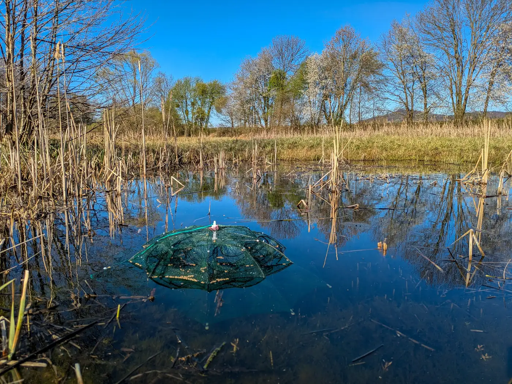
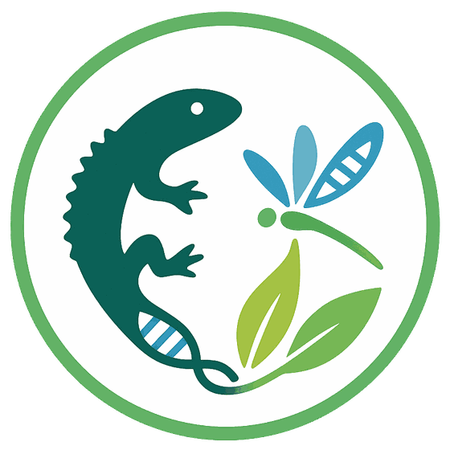
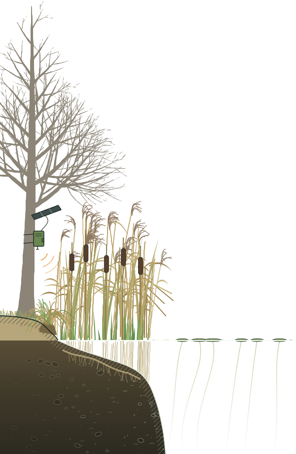
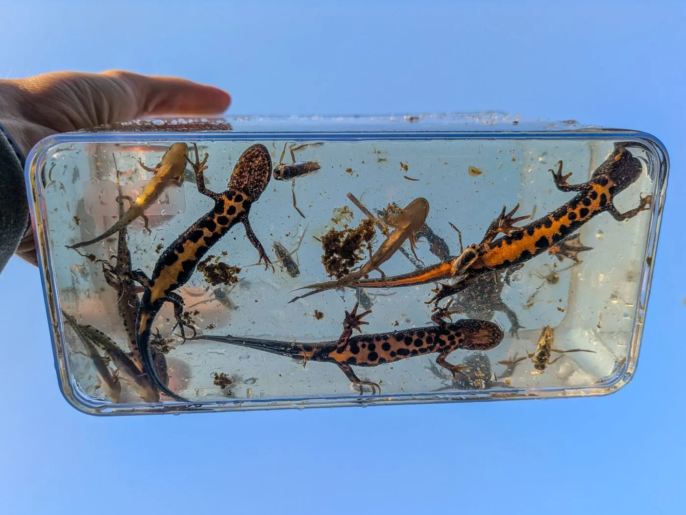
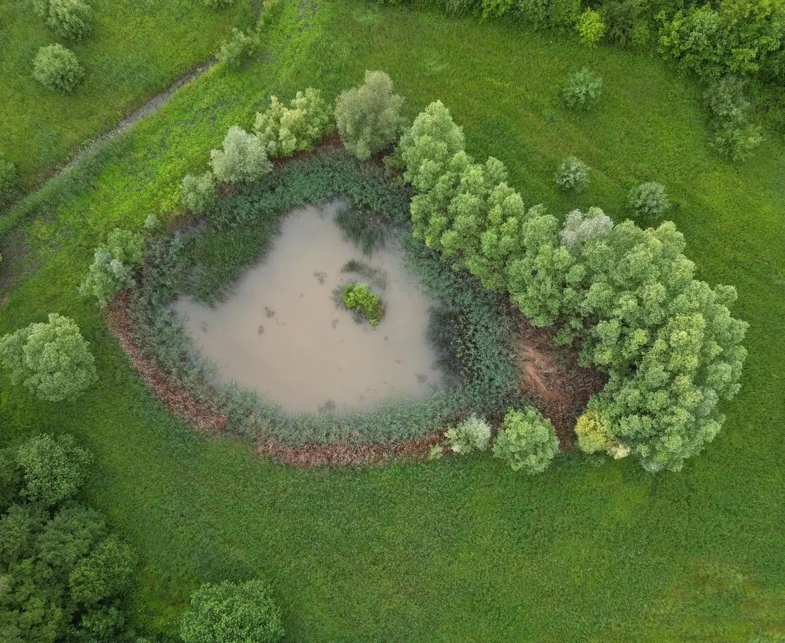
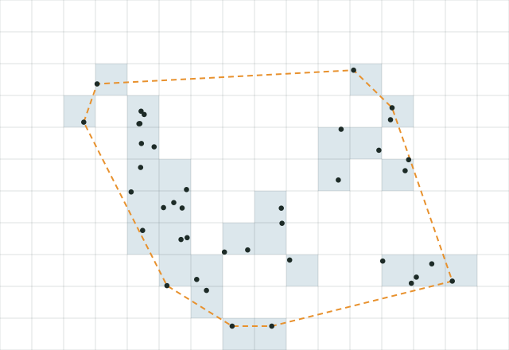
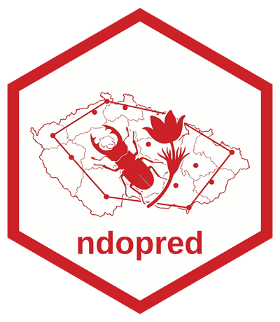

<!--
  Homepage: one transect from the sky to the silt.
    sky         about me, profiles, CV
    the bank    BiodivPond                      } the two main projects
    the water   PhD: amphibian communities in ponds }
    open water  let's work together
    deep water  wider trends in biodiversity: condition evaluation, ndopred
    sediment    recent publications, then the projects and how they cluster
    bottom      get in touch
  Text is plain HTML; edit it in place. Styles: the TRANSECT sections at the
  end of styles.css. js/home.js only switches the navbar colour with depth.

  Included files: _recent.qmd (built from publications.bib by
  _tools/pubs.py) and _timeline.qmd (the project time line, shared with the
  Projects page; how to edit it is at its top).
-->

```{=html}
<div class="descent transect" id="transect">

<div class="air">
<header class="layer sky tx-hero" id="about">
  <div class="wrap hero">
    <div class="hero-text">
      <p class="eyebrow">Ecologist and conservationist</p>
      <h1>Jonáš Gaigr</h1>
      <p class="lead">Monitoring that tells us how nature is doing: amphibians, ponds and Natura&nbsp;2000 in Czechia.</p>
      <p class="affil">I work in the Department of Biodiversity Monitoring at the <a href="https://aopk.gov.cz/web/en">Nature Conservation Agency of the Czech Republic</a> and am a PhD student at the <a href="https://www.fzp.czu.cz/en">Faculty of Environmental Sciences</a>, Czech University of Life Sciences Prague. My work is about systemic change in the methods used to monitor and evaluate the state of species and habitats in the Natura 2000 network and of key umbrella species in Czechia.</p>
      <ul class="profiles" aria-label="Profiles">
        <li><a href="mailto:jonas.gaigr@gmail.com"><i class="bi bi-envelope" aria-hidden="true"></i>Email</a></li>
        <li><a href="https://github.com/jonasgaigr"><i class="bi bi-github" aria-hidden="true"></i>GitHub</a></li>
        <li><a href="https://orcid.org/0009-0004-0267-1382"><i class="bi bi-orcid" aria-hidden="true"></i>ORCID</a></li>
        <li><a href="https://www.linkedin.com/in/jonasgaigr/"><i class="bi bi-linkedin" aria-hidden="true"></i>LinkedIn</a></li>
        <li><a href="https://bsky.app/profile/jonasgaigr.bsky.social"><i class="bi bi-bluesky" aria-hidden="true"></i>Bluesky</a></li>
      </ul>
      <p class="links"><a href="cv.html">Read my CV</a></p>
    </div>
    <figure class="tx-portrait">
      
    </figure>
  </div>
  <!-- Latest: keep three items, newest first -->
  <section class="wrap tx-latest" aria-labelledby="t-latest">
    <h2 id="t-latest">Latest</h2>
    <ol>
      <li><time datetime="2026-11">November 2026</time><a href="projects/biodivpond/index.html">Ran the BiodivPond contributor workshop on the 2027 stakeholder sampling: 500 ponds in ten partner countries, sampled with eDNA.</a></li>
      <li><time datetime="2026-09">September 2026</time><a href="projects/amphibian-communities/index.html">Started my PhD at the Czech University of Life Sciences Prague, on amphibian communities in ponds.</a></li>
      <li><time datetime="2026-09">September 2026</time><a href="cv.html#talks-and-seminars">Second TAIEX expert mission to Kosovo, on transposing the Habitats and Birds Directives.</a></li>
    </ol>
  </section>
  <p class="wrap how"><a href="#t-bank"><span class="how-arrow" aria-hidden="true"></span>Two main projects, then the wider picture</a></p>
</header>

<div class="tx-strip" aria-hidden="true"></div>

<nav class="tx" aria-label="Main projects">
<ol>
  <li class="tx-row tx-bank tx-main-proj" id="t-bank">
    <a href="projects/biodivpond/index.html">
      <span class="tx-layer">The bank, with people <em>Main project · coordinator</em></span>
      <span class="tx-main"><strong>BiodivPond</strong><span class="tx-line">A transnational pond biodiversity monitoring pilot supported by the Biodiversa+ partnership, 2026 to 2028. It tests eDNA and passive acoustic monitoring alongside field surveys in core ponds, and extends monitoring to many more ponds through citizen science.</span></span>
      <span class="tx-img tx-whole tx-badged"></span>
    </a>
  </li>
</ol>
</nav>
</div>

<div class="under tx-under" id="under">
  
  <p class="note note-wl" aria-hidden="true"><svg viewBox="0 0 22 16" width="22" height="16"><path d="M2,1h18L11,11z" fill="none" stroke="currentColor" stroke-width="1.4" stroke-linejoin="round"/><path d="M6,13.5h10M8.5,15.6h5" stroke="currentColor" stroke-width="1.2"/></svg>water surface</p>
  <div class="tx tx-wet">
  <ol>
    <li class="tx-row tx-water tx-focus tx-main-proj" id="t-water">
      <a href="projects/amphibian-communities/index.html">
        <span class="tx-layer">In the water <em>Main project · PhD since September 2026</em></span>
        <span class="tx-main"><strong>Amphibian communities in ponds</strong><span class="tx-line">Supervised by Jiří Vojar, my doctoral project evaluates traditional and novel methods, environmental DNA and passive acoustic monitoring, for monitoring amphibian species of European importance in small water bodies. It also assesses their population status in the Czech Natura 2000 network after seven years of standardised monitoring.</span></span>
        <span class="tx-img tx-whole"></span>
      </a>
    </li>
  </ol>
  </div>

  <section class="wrap tx-ask" aria-labelledby="t-ask">
    <p class="tag"><span id="t-ask">Let's work together</span></p>
    <p class="tx-ask-text">I'm looking to collaborate on exploring <b>biodiversity trends in Czechia</b>, evaluating <b>the condition of protected species</b>, and assessing <b>the impact of conservation interventions</b>.</p>
    <p class="links"><a href="contact.html">Get in touch</a></p>
  </section>

  <section class="tx-deep" aria-labelledby="t-wide">
    <div class="tx-band-head">
      <p class="tag"><span>Deep water</span> the wider picture</p>
      <h2 id="t-wide">Wider trends in biodiversity</h2>
      <p class="tx-band-lead">Beyond single ponds, I build nation-wide tools for the management and governance of biodiversity conservation in Czechia: how species and habitats are doing across the whole country, and how threatened they are.</p>
    </div>
    <div class="tx-tools">
      <a class="tool" href="projects/host-naturecz/index.html">
        <span class="tool-img"></span>
        <span class="tx-layer">National system <em class="q">Nature Conservation Agency</em></span>
        <strong>Condition evaluation of species and habitats</strong>
        <span class="tool-text">A system that evaluates the condition of species and habitats in the Natura 2000 network and of taxa with active species protection tools in place. It aggregates monitoring data, applies the evaluation rules consistently, and produces results that compare between sites, regions and reporting periods.</span>
        <span class="tool-code">Code: host_naturecz</span>
      </a>
      <a class="tool" href="projects/ndopred/index.html">
        <span class="tool-img tool-hex"></span>
        <span class="tx-layer">R package <em class="q">IUCN Red List</em></span>
        <strong>ndopred</strong>
        <span class="tool-text">Turns occurrence records from NDOP, the Agency's species occurrence database, into IUCN Red List metrics and categories for national and regional Red List work: extent of occurrence, area of occupancy and population trends, following the IUCN criteria (v3.1) and the 2024 guidelines. Two Shiny dashboards: one for screening long lists of taxa, one for settling a category taxon by taxon.</span>
      </a>
    </div>
  </section>

  <section class="layer sediment tx-sed" aria-labelledby="t-pubs">
    <div class="sed-top" aria-hidden="true"><svg viewBox="0 0 1000 80" preserveAspectRatio="none" focusable="false"><path class="sed-fill" d="M0,30C260,22 560,58 1000,44L1000,81L0,81Z"/><path class="floc" d="M0,23C260,15 560,51 1000,37" vector-effect="non-scaling-stroke"/><path class="ln" d="M0,30C260,22 560,58 1000,44" vector-effect="non-scaling-stroke"/></svg></div>

    <div class="tx-band-head">
      <p class="tag"><span>The sediment</span> what has settled, newest on top</p>
      <h2 id="t-pubs">Recent publications</h2>
```

<!-- the five newest works, built from publications.bib by _tools/pubs.py -->


```{=html}
      <p class="links"><a href="publications.html">All publications</a></p>
    </div>

    <div class="tx-band-head tx-proj" id="projects-overview">
      <p class="tag"><span>Deeper</span> the projects underneath</p>
      <h2 id="t-proj">Projects, and how they fit together</h2>
      <p class="tx-band-lead">Ten projects, tools and missions in four clusters, on one time line.</p>
```



```{=html}
      <p class="links"><a href="projects.html">All projects</a></p>
    </div>

    <div class="wrap tx-end" id="contact">
      <div>
        <h2>Get in touch</h2>
        <p>I'm always happy to hear from fellow ecologists, conservation practitioners, and anyone working on biodiversity monitoring. The best way to reach me is by email.</p>
        <ul class="contact-links">
          <li><a href="mailto:jonas.gaigr@gmail.com"><i class="bi bi-envelope" aria-hidden="true"></i>jonas.gaigr@gmail.com</a></li>
          <li><a href="https://github.com/jonasgaigr"><i class="bi bi-github" aria-hidden="true"></i>github.com/jonasgaigr</a></li>
          <li><a href="https://orcid.org/0009-0004-0267-1382"><i class="bi bi-orcid" aria-hidden="true"></i>0009-0004-0267-1382</a></li>
          <li><a href="https://www.linkedin.com/in/jonasgaigr/"><i class="bi bi-linkedin" aria-hidden="true"></i>linkedin.com/in/jonasgaigr</a></li>
          <li><a href="https://bsky.app/profile/jonasgaigr.bsky.social"><i class="bi bi-bluesky" aria-hidden="true"></i>jonasgaigr.bsky.social</a></li>
        </ul>
      </div>
      <ul class="tx-more">
        <li><a href="projects.html">Projects</a></li>
        <li><a href="cv.html">Curriculum vitae</a></li>
        <li><a href="publications.html">Publications</a></li>
        <li><a href="contact.html">Get in touch</a></li>
      </ul>
    </div>
  </section>
</div>

</div>
```
