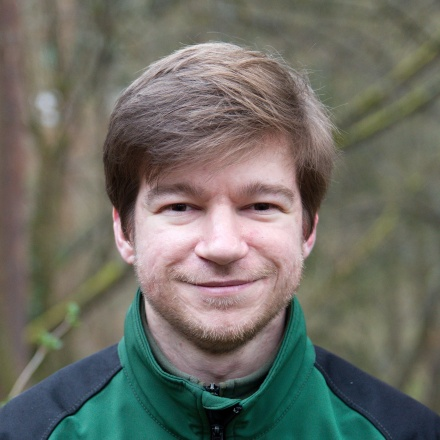
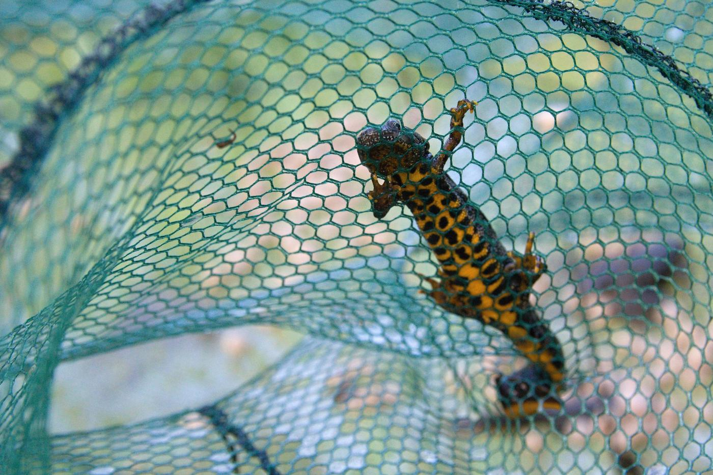
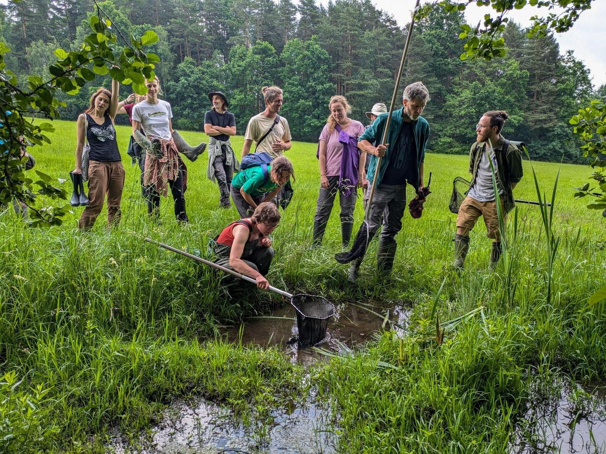
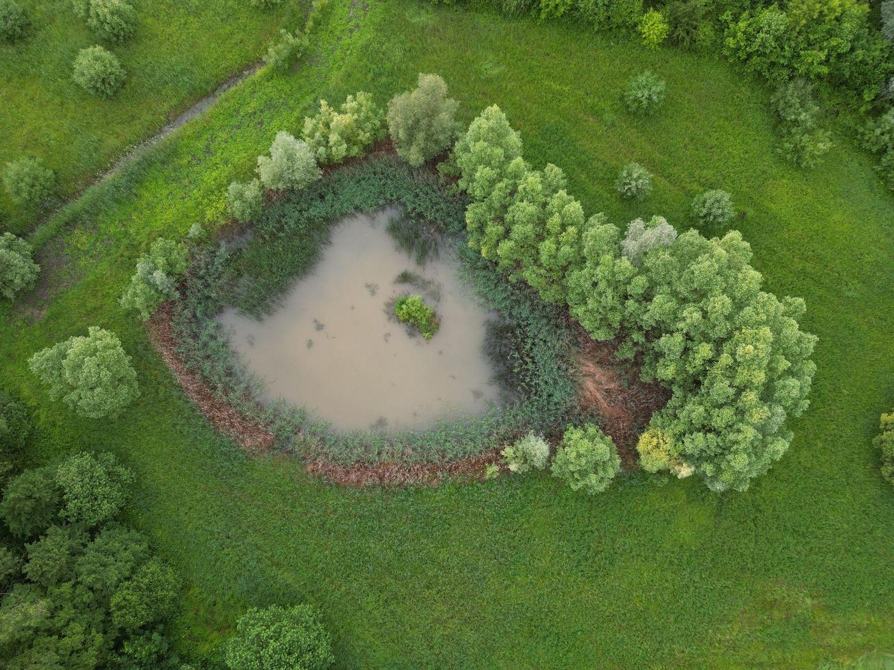
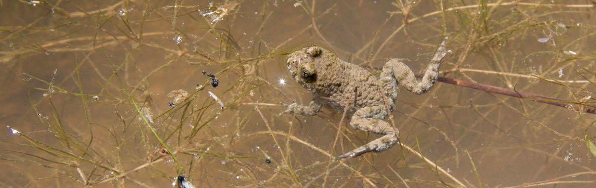
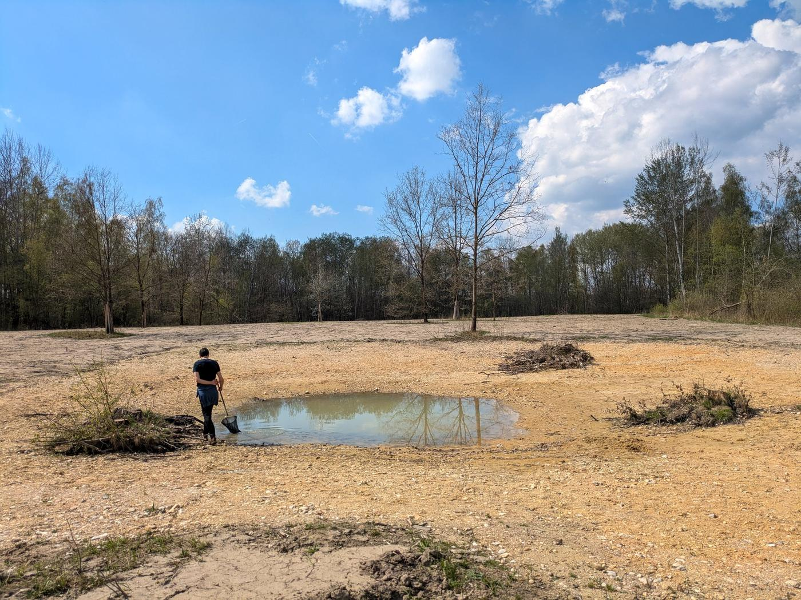
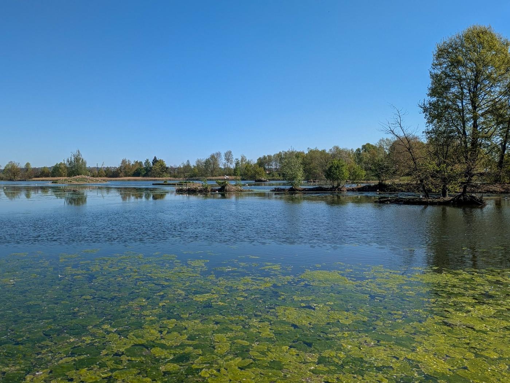

<!--
  Homepage layout, top to bottom:
  banner (fixed pond photo shows through) -> slanted colour bands with
  photo "spotlights" -> a photo window -> feature tiles -> contact over a photo.
  Background photos live in img/home/ and are set in styles.css.
  Each band is a fenced div; edit the markdown inside it as usual.
-->

```{=html}
<section id="banner" class="banner">
  <div class="banner-inner">
    
    <h1 class="banner-title">Hello, I'm Jonáš Gaigr.</h1>
    <p class="banner-tagline">Ecologist &amp; conservationist &middot; amphibians, ponds and Natura&nbsp;2000 monitoring in Czechia</p>
    <ul class="banner-links">
      <li><a href="mailto:jonas.gaigr@gmail.com" title="Email"><i class="bi bi-envelope"></i><span class="visually-hidden">Email</span></a></li>
      <li><a href="https://github.com/jonasgaigr" title="GitHub"><i class="bi bi-github"></i><span class="visually-hidden">GitHub</span></a></li>
      <li><a href="https://orcid.org/0009-0004-0267-1382" title="ORCID"><i class="bi bi-orcid"></i><span class="visually-hidden">ORCID</span></a></li>
      <li><a href="https://www.linkedin.com/in/jonasgaigr/" title="LinkedIn"><i class="bi bi-linkedin"></i><span class="visually-hidden">LinkedIn</span></a></li>
      <li><a href="https://bsky.app/profile/jonasgaigr.bsky.social" title="Bluesky"><i class="bi bi-bluesky"></i><span class="visually-hidden">Bluesky</span></a></li>
    </ul>
    <a class="scroll-cue" href="#about">Explore <i class="bi bi-chevron-down"></i></a>
  </div>
</section>
```

::: {#about .band .tone-1 .top-up .bot-up}
::: {.band-inner .narrow}
[About me]{.kicker}

## Monitoring that tells us how nature is doing {.major}

I am an ecologist and conservationist in the Department of Biodiversity Monitoring at the [Nature Conservation Agency of the Czech Republic](https://aopk.gov.cz/web/en) and a PhD student at the [Faculty of Environmental Sciences](https://www.fzp.czu.cz/en), Czech University of Life Sciences Prague. I work on systemic change in the monitoring and evaluation methods used to assess the state of species and habitats within the Natura 2000 network and key umbrella species in Czechia.

[Read my CV](cv.qmd){.button}
:::
:::

::: {.band .tone-2 .spotlight .top-up .bot-down}
::: {.band-inner}
[{fig-alt="A newt with an orange, black-spotted belly caught in a green dip net"}](cv.qmd#education){.spot-image}

::: {.spot-content}
[🎓 PhD research · since September 2026]{.kicker}

## Amphibians in small waters {.major}

I am a PhD student supervised by [Jiří Vojar](https://wp.czu.cz/cs/index.php/?r=1071&mp=person.info&idClovek=2622). My doctoral project evaluates traditional and novel methods (environmental DNA and passive acoustic monitoring) for monitoring amphibian species of European importance in small water bodies, and assesses their population status in the Czech Natura 2000 network after seven years of standardised monitoring.

[Learn more](cv.qmd#education){.more}
:::
:::
:::

::: {.band .tone-3 .spotlight .flip .top-down .bot-up}
::: {.band-inner}
[{fig-alt="A group of ecologists dip-netting at a pond edge in a meadow"}](projects/biodivpond/index.qmd){.spot-image}

::: {.spot-content}
[🐸 Coordinator · Biodiversa+ pilot]{.kicker}

## BiodivPond {.major}

I coordinate the [BiodivPond pilot](https://biodivpond.github.io), a transnational pond biodiversity monitoring initiative supported by the [Biodiversa+ partnership](https://www.biodiversa.eu/). If you work on amphibian, bat, or aquatic invertebrate monitoring and conservation in Europe, I'd love to hear from you.

[Learn more](projects/biodivpond/index.qmd){.more}
:::
:::
:::

::: {.band .tone-1 .spotlight .top-up .bot-down}
::: {.band-inner}
[{fig-alt="Aerial view of a small pond ringed by willows in green grassland"}](projects/host-naturecz/index.qmd){.spot-image}

::: {.spot-content}
[🔭 Condition evaluation]{.kicker}

## host_naturecz {.major}

My work centres on building a system for the condition evaluation of species and habitats in Czechia across scales, developed in the [host_naturecz](https://github.com/BiodivMonCZ/host_naturecz/) repository.

[Learn more](projects/host-naturecz/index.qmd){.more}
:::
:::
:::

::: {.window .window-forest}
::: {.window-inner}
[👯 Let's work together]{.kicker}

I'm looking to collaborate on exploring **biodiversity trends in Czechia**, evaluating **the condition of protected species**, and assessing **the impact of conservation interventions**.

[Get in touch](contact.qmd){.button}
:::
:::

::: {.band .tone-2 .top-down .bot-up}
::: {.band-inner}
[More of my work]{.kicker}

## Tools, beetles and papers {.major}

::: {.features}
::: {.feature}
[{fig-alt="A yellow-bellied toad floating in shallow water"}](projects/ndopred/index.qmd){.feature-image}

### 📦 ndopred

An R package that turns occurrence records from NDOP (*Nálezová databáze ochrany přírody*, the Agency's species occurrence database) into IUCN Red List metrics and categories for national and regional Red List work. It calculates extent of occurrence, area of occupancy, and population trends following the IUCN criteria (v3.1) and the 2024 guidelines, and ships two Shiny dashboards: one for screening long lists of taxa, one for settling a defensible category taxon by taxon.

[Learn more](projects/ndopred/index.qmd){.more}
:::

::: {.feature}
[[Photo placeholder: *Euoniticellus fulvus*]{.placeholder-label}]{.feature-image .placeholder}

### 💩🐞 Dung beetles

I also dig into the faunistics of European dung beetles, collecting data on their distribution and abundance, like the [occurrence data for *Euoniticellus fulvus*](https://www.researchgate.net/publication/408416676_Prvni_nalez_skvrnare_Euoniticellus_fulvus_Coleoptera_Scarabaeidae_v_zapadnich_Cechach_po_pul_stoleti_First_record_of_sandy_dung_beetle_Euoniticellus_fulvus_Coleoptera_Scarabaeidae_in_western_Bohemia_i).

[Read the note](https://www.researchgate.net/publication/408416676_Prvni_nalez_skvrnare_Euoniticellus_fulvus_Coleoptera_Scarabaeidae_v_zapadnich_Cechach_po_pul_stoleti_First_record_of_sandy_dung_beetle_Euoniticellus_fulvus_Coleoptera_Scarabaeidae_in_western_Bohemia_i){.more}
:::

::: {.feature}
[{fig-alt="A newly dug pond in bare sandy ground with a person sampling at its edge"}](projects.qmd){.feature-image}

### 🚀 Projects

The pilots, LIFE projects and partnerships I work in, from Biodiversa+ to PROSPECTIVE LIFE, and the tools that come out of them.

[All projects](projects.qmd){.more}
:::

::: {.feature}
[{fig-alt="A broad pond with submerged vegetation under a clear blue sky"}](publications.qmd){.feature-image}

### 📚 Publications

Papers, reports and notes on biodiversity monitoring, insect conservation and faunistics.

[All publications](publications.qmd){.more}
:::
:::
:::
:::

::: {#contact .contact-band}
::: {.band-inner .narrow}
## Get in touch {.major}

I'm always happy to hear from fellow ecologists, conservation practitioners, and anyone working on biodiversity monitoring. The best way to reach me is by [email](mailto:jonas.gaigr@gmail.com).

```{=html}
<ul class="contact-links">
  <li><i class="bi bi-envelope"></i><a href="mailto:jonas.gaigr@gmail.com">jonas.gaigr@gmail.com</a></li>
  <li><i class="bi bi-github"></i><a href="https://github.com/jonasgaigr">github.com/jonasgaigr</a></li>
  <li><i class="bi bi-orcid"></i><a href="https://orcid.org/0009-0004-0267-1382">0009-0004-0267-1382</a></li>
  <li><i class="bi bi-linkedin"></i><a href="https://www.linkedin.com/in/jonasgaigr/">linkedin.com/in/jonasgaigr</a></li>
  <li><i class="bi bi-bluesky"></i><a href="https://bsky.app/profile/jonasgaigr.bsky.social">jonasgaigr.bsky.social</a></li>
</ul>
```
:::
:::
