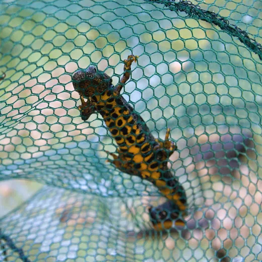
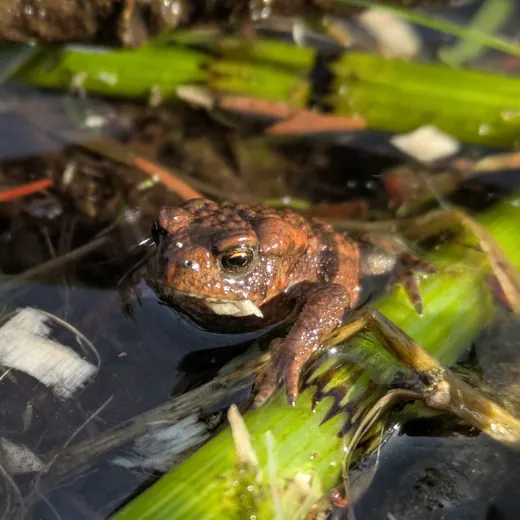
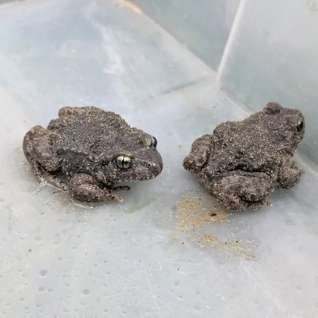
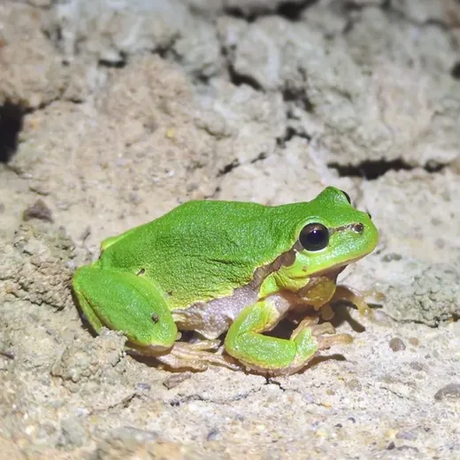
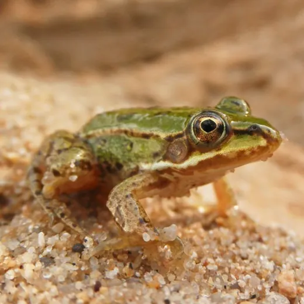
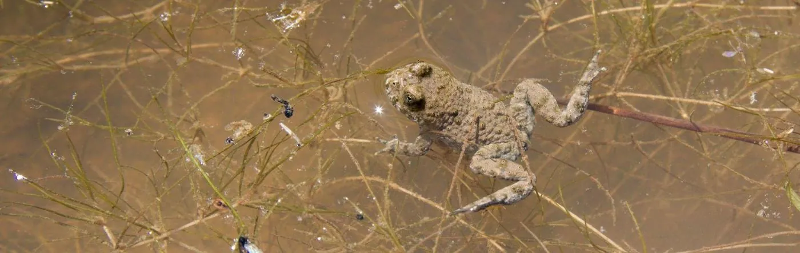
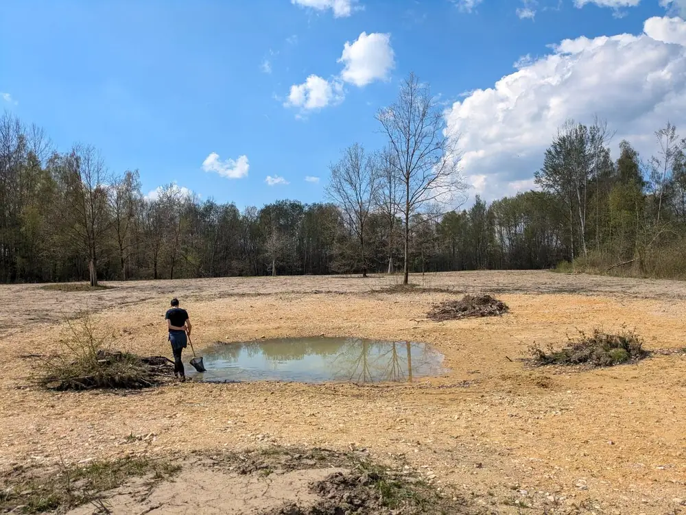

<!--
  The PhD project page (formerly "Amphibians in small waters"). The registered
  thesis title is unchanged and quoted below.
  Sources, as of November 2026:
    PhD-interview-presentation  talks/2026-10-ecology-seminar (aims, methods, plan)
    amphibian-condition-czechia report/report.md, section 15 (Natura 2000 trends, losses)
    amphimon-czechia            output/report (monitoring coverage of the range)
    mPPKobojzivelnici           report/REPORT_en.md of 4 November 2026 (created ponds)
    BiodivPond.github.io        core_pond_dataset.qmd, about.qmd
  RULE FOR THE WHOLE PAGE: describe questions, data and methods, not answers.
  Keep hypotheses and unpublished findings few and general: no expected
  outcomes, no effect sizes, trends or percentages from unpublished analyses.
  Published results (with a citation) are fine. trap counts and ddPCR are
  compared, not calibrated against each other.
  Photos: img/projects/amphibian-communities/, the owner's own.
  Styles: "PROJECT PAGE: Amphibian communities in ponds" at the end of styles.css.
-->

```{=html}
<dl class="ac-meta">
  <div><dt>PhD</dt><dd>Since September 2026</dd></div>
  <div><dt>Where</dt><dd><a href="https://www.fzp.czu.cz/en">Faculty of Environmental Sciences</a>, Czech University of Life Sciences Prague</dd></div>
  <div><dt>Supervision</dt><dd><span><a href="https://wp.czu.cz/cs/index.php/?r=1071&amp;mp=person.info&amp;idClovek=2622">Jiří Vojar</a>, supervisor</span><span>Lenka Jeřábková, co&#8209;supervisor</span></dd></div>
</dl>
```

::: {.ac-lead}
A pond's amphibian community is the set of species that breed in it, how many of them there are, and how that changes from year to year. Ponds hold up to 70&nbsp;% of the freshwater species in European landscapes, but they are small, numerous and scattered, so most monitoring schemes pass them by. And a survey that misses a species does not show that it is absent: whether we call a population stable or declining depends on how reliably each method finds it, and at what cost.
:::

My PhD asks how well we can see these communities, and what the Czech monitoring data already say about them. Its field data come from [BiodivPond](../biodivpond/index.qmd), the European pond monitoring pilot I coordinate, where the same ponds are surveyed by several methods on the same dates.

::: {.ac-topic}
Registered thesis topic: *Monitoring methods for amphibian species of European importance in small water bodies and the assessment of their population status in the Czech Natura 2000 network*
:::

## Three questions

```{=html}
<ol class="ac-q">
  <li>
    <span class="ac-q-n" aria-hidden="true">1</span>
    <span class="ac-q-tag">Methods</span>
    <p>How well do environmental DNA and passive acoustic monitoring find a pond's amphibians, compared with traps, nets and night counts at the same pond on the same date?</p>
  </li>
  <li>
    <span class="ac-q-n" aria-hidden="true">2</span>
    <span class="ac-q-tag">Status</span>
    <p>How are the amphibians of European importance doing in the Czech Natura 2000 network after seven years of standardised monitoring, and do ponds created for amphibians work?</p>
  </li>
  <li>
    <span class="ac-q-n" aria-hidden="true">3</span>
    <span class="ac-q-tag">Ponds</span>
    <p>What shapes amphibian communities across Europe: the water, its vegetation and fish, or the land around the pond?</p>
  </li>
</ol>
```

## Who lives in a pond

Five of the species I meet in Czech ponds. Each method sees this community differently: a trap holds whatever swims into it overnight, a recorder hears only the species that call, and eDNA finds the species that have left DNA in the water.

::: {.column-page}
```{=html}
<figure class="ac-strip">
  <ul>
    <li><span class="ac-sp">Great crested newt <span class="ac-sci"><i>Triturus cristatus</i></span></span><span class="ac-annex">Annex II</span></li>
    <li><span class="ac-sp">Common toad <span class="ac-sci"><i>Bufo bufo</i></span></span></li>
    <li><span class="ac-sp">Common spadefoot <span class="ac-sci"><i>Pelobates fuscus</i></span></span></li>
    <li><span class="ac-sp">European tree frog <span class="ac-sci"><i>Hyla arborea</i></span></span></li>
    <li><span class="ac-sp">Water frog <span class="ac-sci"><i>Pelophylax</i>&nbsp;sp.</span></span></li>
  </ul>
  <figcaption>Annex II: one of the six Czech species listed in Annex II of the Habitats Directive, whose status Czechia reports to the EU every six years. Photographs: Jonáš Gaigr.</figcaption>
</figure>
```
:::

## One pond, three ways of looking

BiodivPond surveys the same core ponds with three kinds of method. Comparing what each finds, pond by pond and date by date, is the core of the methods question.

::: {.column-page}
```{=html}
<figure class="ac-diagram">
  <svg viewBox="0 0 1000 320" role="img" aria-labelledby="ac-d-title ac-d-desc" focusable="false">
    <title id="ac-d-title">Where each method samples, in one pond</title>
    <desc id="ac-d-desc">A cross-section of a pond. a: an umbrella trap stands on the bottom of the shallow, vegetated margin, 25 to 50 centimetres deep, with a float at the surface. b: water is taken from several points across the surface and pooled into one sample. c: a recorder on a tree on the bank picks up the call of a frog at the water's edge.</desc>
    <defs>
      <pattern id="ac-hatch" width="7" height="7" patternUnits="userSpaceOnUse" patternTransform="rotate(45)"><line x1="0" y1="0" x2="0" y2="7" class="ac-hatch-line"/></pattern>
      <pattern id="ac-mesh" width="6" height="6" patternUnits="userSpaceOnUse" patternTransform="rotate(30)"><path d="M0,0H6M0,0V6" class="ac-mesh-line"/></pattern>
    </defs>

    <!-- water, then the ground over it -->
    <path class="ac-water" d="M232,170 C250,186 268,200 300,206 C350,214 390,262 450,280 C520,300 600,302 660,290 C720,278 760,230 790,206 C800,196 808,183 818,170 Z"/>
    <path class="ac-ground" d="M0,150 C80,148 150,146 190,152 C210,156 222,162 232,170 C250,186 268,200 300,206 C350,214 390,262 450,280 C520,300 600,302 660,290 C720,278 760,230 790,206 C800,196 808,183 818,170 C834,152 860,140 920,138 C950,137 980,138 1000,138 L1000,320 L0,320 Z"/>
    <path class="ac-gline" d="M0,150 C80,148 150,146 190,152 C210,156 222,162 232,170 C250,186 268,200 300,206 C350,214 390,262 450,280 C520,300 600,302 660,290 C720,278 760,230 790,206 C800,196 808,183 818,170 C834,152 860,140 920,138 C950,137 980,138 1000,138"/>
    <path class="ac-surface" d="M232,170H818"/>
    <!-- the surveyor's water-level mark -->
    <g class="ac-wl"><path d="M654,158h14l-7,9z"/><path d="M656,173h10M659,177h4"/></g>

    <!-- reeds and grass -->
    <g class="ac-reed">
      <path d="M204,156 C203,130 205,108 208,90"/><path d="M212,159 C213,134 216,116 222,100"/><path d="M219,162 C217,140 212,124 206,112"/>
      <path d="M744,236 C743,200 745,150 747,112"/><path d="M752,226 C753,190 757,152 763,126"/><path d="M759,218 C757,186 751,160 742,140"/>
      <path d="M836,150 C835,128 838,110 842,96"/><path d="M843,147 C845,126 849,114 856,104"/>
      <path d="M40,149l-3-9M44,149l2-10M48,149l5-7M120,147l-3-8M124,147l1-10M128,147l5-8M968,138l-3-9M972,138l2-10M976,138l5-7"/>
    </g>

    <!-- a: the umbrella trap on the bottom of the margin, its float at the surface -->
    <path class="ac-trap" d="M264,199 Q268,180 297,176 Q326,180 331,208 Z"/>
    <path class="ac-trap-ribs" d="M297,176L267,199M297,176L283,203M297,176L313,206M297,176L329,208"/>
    <path class="ac-line" d="M297,176V171"/>
    <rect class="ac-float" x="290" y="162" width="14" height="9" rx="3"/>
    <g class="ac-dim">
      <path d="M346,170V208M341,170h10M341,208h10"/>
      <text x="356" y="194">25–50 cm</text>
    </g>

    <!-- b: several points across the surface, pooled into one sample -->
    <g class="ac-fan"><path d="M390,170L547,99"/><path d="M500,170L552,100"/><path d="M610,170L558,100"/><path d="M720,170L563,99"/></g>
    <g class="ac-pt"><circle cx="390" cy="170" r="4.5"/><circle cx="500" cy="170" r="4.5"/><circle cx="610" cy="170" r="4.5"/><circle cx="720" cy="170" r="4.5"/></g>
    <g class="ac-bottle">
      <rect x="541" y="58" width="28" height="41" rx="5"/>
      <path class="ac-fill" d="M542.5,78h25v15.5a4,4 0 0 1 -4,4h-17a4,4 0 0 1 -4,-4z"/>
      <rect x="548" y="50" width="14" height="9"/>
      <rect x="546" y="44" width="18" height="7" rx="1.5"/>
    </g>
    <text class="ac-dim ac-note" x="555" y="200">water from several points</text>

    <!-- c: a calling frog at the edge, the recorder on a tree on the bank -->
    <g class="ac-frog"><ellipse cx="771" cy="171" rx="12" ry="5"/><circle cx="765" cy="166" r="3.4"/><circle cx="777" cy="166" r="3.4"/></g>
    <g class="ac-call"><path d="M780.7,142.6A18,18 0 0 1 793.4,155.3"/><path d="M783.8,131A30,30 0 0 1 805,152.2"/><path d="M786.9,119.4A42,42 0 0 1 816.6,149.1"/></g>
    <text class="ac-dim ac-note" x="812" y="116">calls</text>
    <path class="ac-trunk" d="M902,139 C903,100 903,40 901,0 H919 C917,40 917,100 920,139 Z"/>
    <path class="ac-line" d="M917,52 C930,38 944,26 962,14M904,30 C894,20 886,12 874,4"/>
    <polygon class="ac-panel" points="878,64 911,57 915,71 882,78"/>
    <path class="ac-line" d="M897,74V80"/>
    <rect class="ac-box" x="890" y="80" width="22" height="30" rx="2"/>
    <path class="ac-strap" d="M899,88H921M899,102H921"/>

    <!-- markers -->
    <g class="ac-mk"><circle cx="297" cy="128" r="14"/><text x="297" y="128">a</text></g>
    <text class="ac-lbl" x="277" y="133" text-anchor="end">umbrella trap</text>
    <g class="ac-mk"><circle cx="600" cy="62" r="14"/><text x="600" y="62">b</text></g>
    <text class="ac-lbl" x="620" y="67">one pooled water sample</text>
    <g class="ac-mk"><circle cx="864" cy="40" r="14"/><text x="864" y="40">c</text></g>
    <text class="ac-lbl" x="844" y="45" text-anchor="end">recorder</text>
  </svg>
  <figcaption>Where each method samples, in one pond. Not to scale.</figcaption>
</figure>

<div class="ac-methods">
  <section aria-labelledby="ac-m-a">
    <p class="ac-m-head"><span class="ac-mk-key" aria-hidden="true">a</span><span class="ac-m-kind">Traditional</span></p>
    <h3 id="ac-m-a">Umbrella traps</h3>
    <p>The standard. Hexagonal mesh traps stand among vegetation 0.5–1.5&nbsp;m from the shore and 25–50&nbsp;cm deep, from sunset to sunrise. An air-filled bottle keeps the top above water, so nothing drowns.</p>
    <dl>
      <dt>Records</dt><dd>Species, life stage and sex, and the belly pattern of each crested newt, so an animal can be recognised when it is caught again.</dd>
      <dt>Limit</dt><dd>One night with six traps detects the great crested newt only about 40&nbsp;% of the time (Kröpfli et&nbsp;al. 2010).</dd>
    </dl>
  </section>
  <section aria-labelledby="ac-m-b">
    <p class="ac-m-head"><span class="ac-mk-key" aria-hidden="true">b</span><span class="ac-m-kind">Novel</span></p>
    <h3 id="ac-m-b">Environmental DNA</h3>
    <p>Water from several points around the pond, pooled into one sample and filtered on site, then analysed at the pilot's eDNA hub at INBO in Belgium. Metabarcoding lists many species from one sample, fish and invertebrates included; a targeted ddPCR assay looks for crested newts alone.</p>
    <dl>
      <dt>Records</dt><dd>Which species are present, including rare and hidden ones, in data comparable across many ponds.</dd>
      <dt>Limit</dt><dd>Not how many animals or which life stages, and nothing for species missing from the reference library.</dd>
    </dl>
  </section>
  <section aria-labelledby="ac-m-c">
    <p class="ac-m-head"><span class="ac-mk-key" aria-hidden="true">c</span><span class="ac-m-kind">Novel</span></p>
    <h3 id="ac-m-c">Passive acoustic monitoring</h3>
    <p>A recorder at the pond, at 47 of the 60 core ponds in 2026. The processing builds on the pipeline of the Biodiversa+ automated monitoring pilot, which recognises birds and bats.</p>
    <dl>
      <dt>Records</dt><dd>Calling frogs and toads (water frogs, tree frogs, fire-bellied toads) and bats.</dd>
      <dt>Limit</dt><dd>Newts do not call, and amphibian calls are a step the existing pipeline does not yet cover. A first pass at adding them is part of this project.</dd>
    </dl>
  </section>
</div>
```
:::

::: {.ac-expect}
**The comparison.** At each pond and date, the species found by eDNA are compared with those caught in traps, and the crested newt ddPCR results with the trap counts.
:::

## The data

Three datasets, one European and two Czech, each answering a different part of the questions.

::: {.column-page}
```{=html}
<div class="ac-data">
  <section>
    <p class="ac-d-where">Europe <span>BiodivPond</span></p>
    <p class="ac-d-num">60</p>
    <h3 class="ac-d-what">core ponds sampled in 2026</h3>
    <p>eDNA at all 60, traditional surveys at 48, acoustic recorders at 47. In 2027 citizen scientists sample another 500 ponds for eDNA.</p>
  </section>
  <section>
    <p class="ac-d-where">Czechia <span>Natura 2000 monitoring</span></p>
    <p class="ac-d-num">6</p>
    <h3 class="ac-d-what">Annex II species, <span class="ac-nw">2020–2025</span></h3>
    <p>Counts, abundance classes and habitat records from 1,589 sites.</p>
  </section>
  <section>
    <p class="ac-d-where">Czechia <span>Created ponds</span></p>
    <p class="ac-d-num">172</p>
    <h3 class="ac-d-what">ponds created or restored for amphibians, <span class="ac-nw">2009–2025</span></h3>
    <p>The Agency's Pond Restoration Effectiveness Monitoring of subsidised ponds: 572 site-years and 1,685 visits, recording every species and life stage, and the pond itself: depth, shading, vegetation and fish.</p>
  </section>
</div>
```
:::

## Analyses under way

::: {.ac-wip}
Work in progress. Results will follow in publications.
:::

::: {.column-page}
```{=html}
<section class="ac-res ac-res-wide" aria-labelledby="ac-r1">
  <figure class="ac-res-photo">
    
    <figcaption>Yellow-bellied toad, <i>Bombina variegata</i></figcaption>
  </figure>
  <h3 id="ac-r1">Natura 2000 sites, <span class="ac-nw">2020–2025</span></h3>
  <ul class="ac-find">
    <li><b>Population trends</b> of the six Annex II species, from counts and abundance classes, and how robust they are to the choice of estimator and of sites.</li>
    <li><b>Apparent local losses:</b> how many are real, and how many are populations that simply went undetected in one season.</li>
  </ul>
</section>

<section class="ac-res ac-res-side" aria-labelledby="ac-r2">
  <div>
    <h3 id="ac-r2">Created and restored ponds, <span class="ac-nw">2009–2025</span></h3>
    <ul class="ac-find">
      <li><b>Trends</b> of single species and of species richness across the monitored ponds.</li>
      <li><b>Colonisation:</b> how quickly new ponds gain their species, and what role management plays.</li>
    </ul>
    <p class="ac-res-note">A manuscript is planned for mid&#8209;2027.</p>
  </div>
  <figure class="ac-res-photo">
    
    <figcaption>A newly dug pond</figcaption>
  </figure>
</section>
```
:::

## What comes next

::: {.column-page}
```{=html}
<ol class="ac-next">
  <li>
    <p class="ac-next-when">2026/27 <span>year one</span></p>
    <ul>
      <li>Natura 2000 trends and their drivers: habitat, land cover, drought</li>
      <li>The created-ponds manuscript, by mid&#8209;2027</li>
      <li>The BiodivPond core pond dataset, on GBIF and Zenodo</li>
      <li>eDNA against traditional surveys: the same species at the same pond and date?</li>
      <li>Crested newt ddPCR compared with trap counts</li>
      <li>A first pass at calling frogs and toads in the recordings</li>
      <li>The 2027 citizen-science season, 500 ponds</li>
    </ul>
  </li>
  <li>
    <p class="ac-next-when">2027/28 <span>year two</span></p>
    <ul>
      <li>The methods manuscript: eDNA, acoustic and traditional detection compared</li>
      <li>The inter-laboratory eDNA ring test, as a contributor</li>
      <li>Pond conditions and richness at the core ponds: nutrients, vegetation, land use, and fish from eDNA</li>
      <li>Field and processing time for each method</li>
    </ul>
  </li>
  <li>
    <p class="ac-next-when">Later</p>
    <ul>
      <li>Natura 2000 drivers: local factors (management, hydrology, fish) against the landscape (land cover, land use, connectivity)</li>
      <li>Ponds across Europe: land cover and fish across 560 core and citizen-science ponds</li>
    </ul>
  </li>
</ol>
```
:::

## Where it connects

::: {.column-page}
```{=html}
<ul class="ac-links">
  <li>
    <a href="../biodivpond/index.html">
      <span class="ac-l-kind">Biodiversa+ pilot · I coordinate it</span>
      <b>BiodivPond</b>
      <span>The field backbone: core ponds, eDNA, acoustic recorders and the citizen-science scheme.</span>
    </a>
  </li>
  <li>
    <div>
      <span class="ac-l-kind">TA ČR · 2026 to 2028</span>
      <b>eDNA4Nature</b>
      <span>eDNA tools for aquatic biodiversity, led by the Faculty of Environmental Sciences. Its certified methodology is meant for the Agency's monitoring; I represent the Agency as its end user.</span>
    </div>
  </li>
  <li>
    <a href="../prospective-life/index.html">
      <span class="ac-l-kind">Integrated LIFE project</span>
      <b>PROSPECTIVE LIFE</b>
      <span>The recommendations feed the planned action plans for the natterjack toad (<i>Epidalea calamita</i>) and the Carpathian newt.</span>
    </a>
  </li>
</ul>
```
:::

::: {.page-links}
[Seminar slides, October 2026](https://jonasgaigr.github.io/PhD-interview-presentation/){.btn .btn-outline-primary role="button"}
[BiodivPond website](https://biodivpond.github.io){.btn .btn-outline-primary role="button"}
[Thesis topic in my CV](../../cv.qmd#education){.btn .btn-outline-primary role="button"}
:::
